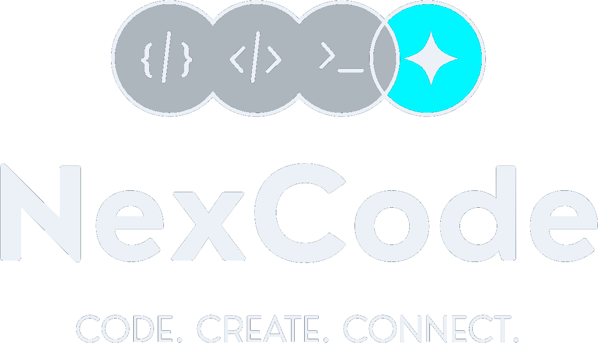
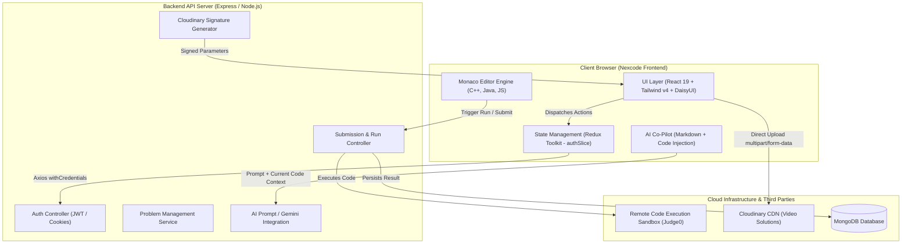

# ⚡ Nexcode — Modern Online Judge & Competitive Programming Platform

<div align="center">



### *An enterprise-grade, full-stack algorithmic coding platform and judge system featuring an embedded Monaco IDE, multi-language code compilation, an intelligent AI-powered co-pilot, role-based administration, and cloud video editorials.*

[](https://react.dev/)
[](https://vite.dev/)
[](https://tailwindcss.com/)
[](https://daisyui.com/)
[](https://redux-toolkit.js.org/)
[](https://microsoft.github.io/monaco-editor/)
[](https://cloudinary.com/)
[](LICENSE)

[Features](#-key-features) • [System Architecture](#-system-architecture) • [Tech Stack](#-tech-stack) • [Folder Structure](#-folder-structure) • [Installation](#-getting-started) • [API Contracts](#-api-integration) • [Engineering Highlights](#-engineering-highlights--trade-offs)

</div>

---

## 📖 Overview

**Nexcode** is an interactive, browser-based coding platform engineered to deliver the developer experience of platforms like LeetCode and Codeforces, elevated with modern AI assistance and media workflows.

Built from the ground up on **React 19**, **Tailwind CSS v4**, and **Redux Toolkit**, the frontend provides a zero-latency IDE environment powered by Microsoft's **Monaco Editor**. Beyond code execution and test verification, Nexcode integrates a built-in **AI Coding Assistant** that offers context-aware algorithmic hints, code analysis, and one-click code-injection, alongside direct-to-cloud signed video upload pipelines for problem video editorials.

---

## ✨ Key Features

### 💻 1. Dual-Pane Competitive Coding IDE
- **Monaco Code Editor**: Full VS Code engine embedded in the browser with dark theme (`vs-dark`), multi-language syntax highlighting, line folding, automated layout resizing, and font scaling.
- **Polyglot Execution**: First-class support for **C++**, **Java**, and **JavaScript**, complete with automated boilerplate and starter code initialization per problem.
- **Run & Submit Workflows**:
  - **Run Console**: Instant test-case verification comparing user stdout with expected outputs across public sample cases.
  - **Judge Submission**: Strict test harness evaluation checking against hidden benchmark test cases, reporting status (*Accepted, Wrong Answer, Time Limit Exceeded*), runtime (seconds), and memory footprints (kB/MB).

### 🤖 2. Context-Aware AI Problem-Solving Assistant (`ChatAi`)
- **Integrated Assistant Workspace**: Accessible directly within the problem interface without switching tabs.
- **Actionable Prompt Accelerators**: One-click actions for `"Give me a hint"`, `"Analyze my code"`, and `"Explain optimal approach"`.
- **One-Click Code Sync (`Apply to Editor`)**: Directly injects AI-generated solutions or refactored snippets into the active Monaco editor instance.
- **Real-Time Animated Stream**: Character-by-character typewriter reveal mechanism with automatic bottom-anchor scrolling.
- **Markdown & Syntax Highlighting**: Formatted mathematical notations, code fences with Prism syntax highlighting (`oneDark`), copy-to-clipboard badges, and user feedback toggles.

### 🛡️ 3. Robust Authentication & RBAC (Role-Based Access Control)
- **Token / Cookie Authenticated Sessions**: Redux-managed auth state persisted with initial session handshake (`/user/check`).
- **Role-Gated Routes**: Dedicated route guards (`/admin/*`) strictly restricting management suites to authorized admin accounts.
- **Schema-Driven Forms**: Fully validated login and registration workflows powered by **React Hook Form** and **Zod** schemas.

### ⚙️ 4. Comprehensive Admin Problem-Authoring Suite
- **Dynamic Problem Creator**:
  - Controlled form state with `useFieldArray` for dynamically appending and deleting test cases.
  - Granular separation between visible public sample test cases and hidden test cases.
  - Multi-language starter code and complete reference solutions management (C++, Java, JS).
- **Direct-to-Cloud Video Upload Pipeline**:
  - Secure Cloudinary direct multipart uploads via backend-generated cryptographic signatures (`HMAC-SHA1`).
  - Real-time progress bar tracking byte-level upload metrics (`onUploadProgress`).
  - Seamless editorial video association and video deletion mechanisms.
- **Problem Lifecycle Management**: Real-time problem updating and deletion with confirmation safeguards.

### 📊 5. Problem Catalog & Analytics
- **Dynamic Filtering Engine**: Multi-dimensional filtering by Difficulty (*Easy*, *Medium*, *Hard*), Data Structure Tag (*Array*, *Linked List*, *Graph*, *DP*), and User Status (*Solved* vs. *All*).
- **Solved State Tracking**: Visual badges identifying previously solved challenges per authenticated profile.
- **Submission History**: Chronological audit log of all previous submissions per problem with execution runtime, memory utilization, and formatted timestamps.

---

## 🏗 System Architecture

The following diagram illustrates how the Nexcode frontend interacts with state, external execution engines, Cloudinary media pipelines, and AI services:



---

## 🛠 Tech Stack

### Core Framework & Build
| Technology | Version | Description |
| :--- | :--- | :--- |
| **[React](https://react.dev/)** | `^19.2.8` | Declarative UI library with latest React 19 concurrent features |
| **[Vite](https://vite.dev/)** | `^8.2.0` | Ultra-fast build engine with native ES module HMR |
| **[React Router](https://reactrouter.com/)** | `^7.18.2` | Client-side routing, protected navigation, and dynamic route matching |

### State & Networking
| Technology | Version | Description |
| :--- | :--- | :--- |
| **[Redux Toolkit](https://redux-toolkit.js.org/)** | `^2.12.0` | Predictable global state management, async thunks & reducers |
| **[React Redux](https://react-redux.js.org/)** | `^9.3.0` | Official React bindings for Redux state subscription |
| **[Axios](https://axios-http.com/)** | `^1.19.0` | Promise-based HTTP client configured with cookie credentials |

### Editor, AI & Markdown
| Technology | Version | Description |
| :--- | :--- | :--- |
| **[@monaco-editor/react](https://github.com/suren-atoyan/monaco-react)** | `^4.7.0` | Browser-based VS Code editor integration |
| **[React Markdown](https://github.com/remarkjs/react-markdown)** | `^10.1.0` | Render markdown responses from AI assistant safely |
| **[Remark GFM](https://github.com/remarkjs/remark-gfm)** | `^4.0.1` | GitHub Flavored Markdown support (tables, autolinks, tasklists) |
| **[React Syntax Highlighter](https://github.com/react-syntax-highlighter/react-syntax-highlighter)** | `^16.1.2` | Prism syntax highlighting (`oneDark` theme) for code blocks |

### Forms & Validation
| Technology | Version | Description |
| :--- | :--- | :--- |
| **[React Hook Form](https://react-hook-form.com/)** | `^7.85.0` | High-performance, re-render-isolated form state |
| **[Zod](https://zod.dev/)** | `^4.4.3` | TypeScript-first schema declaration and runtime validation |
| **[@hookform/resolvers](https://github.com/react-hook-form/resolvers)** | `^5.9.1` | Zod resolver bridge for React Hook Form |

### Styling & UI Components
| Technology | Version | Description |
| :--- | :--- | :--- |
| **[Tailwind CSS v4](https://tailwindcss.com/)** | `^4.3.3` | Next-generation utility-first CSS framework with `@tailwindcss/vite` |
| **[DaisyUI](https://daisyui.com/)** | `^5.7.17` | Semantic component system for Tailwind CSS |
| **[Lucide React](https://lucide.dev/)** | `^1.31.0` | Modern, consistent SVG icon set |

---

## 📁 Folder Structure

```text
nexcode-frontend/
├── public/
│   ├── favicon.svg               # Application browser icon
│   └── icons.svg                 # SVG sprite sheet
├── src/
│   ├── assets/                   # Brand assets, logos, and UI banners
│   │   ├── hero.png
│   │   ├── nexcode-logo-dark.png
│   │   ├── nexcode-logo-transparent.png
│   │   └── nexcode-mark.png
│   ├── components/               # Modular, reusable component library
│   │   ├── ai/                   # AI sub-components
│   │   │   ├── ChatMessage.jsx   # Formatted markdown message renderer
│   │   │   ├── CodeBlock.jsx     # Syntax-highlighted code block with 'Apply' button
│   │   │   └── TypingIndicator.jsx # Animated pulse indicator during AI inference
│   │   ├── AdminDelete.jsx       # Problem removal view
│   │   ├── AdminPanel.jsx        # Problem creation form with dynamic test cases
│   │   ├── AdminUpload.jsx       # Direct Cloudinary signed video uploader
│   │   ├── AdminVideo.jsx        # Video editorial management table
│   │   ├── ChatAi.jsx            # Real-time AI co-pilot container with suggestions
│   │   ├── NexcodeLogo.jsx       # Responsive brand logo component
│   │   └── SubmissionHistory.jsx # Historical submission results table
│   ├── pages/                    # High-level route views
│   │   ├── Admin.jsx             # Admin dashboard navigation hub
│   │   ├── Homepage.jsx          # Problem repository, filter drawer, & status metrics
│   │   ├── Login.jsx             # Zod-validated authentication page
│   │   ├── ProblemPage.jsx       # Split-pane interactive IDE and judge arena
│   │   └── Signup.jsx            # User onboarding & registration page
│   ├── store/                    # Redux Toolkit centralized store configuration
│   │   └── store.js              # Global store initialization
│   ├── utils/                    # Core utilities and networking helpers
│   │   └── axiosClient.js        # Centralized Axios instance with credentials
│   ├── App.css                   # Global styles
│   ├── App.jsx                   # Route registry & Protected Route boundaries
│   ├── authSlice.js              # Redux slice: async thunks for auth lifecycle
│   ├── index.css                 # Tailwind CSS v4 and DaisyUI imports & animations
│   └── main.jsx                  # React DOM root entry point
├── eslint.config.js              # ESLint configuration
├── index.html                    # HTML document template
├── package.json                  # Dependencies & scripts
└── vite.config.js                # Vite build configuration with Tailwind v4 plugin
```

---

## 🚀 Getting Started

### Prerequisites
- **Node.js**: `v18.0.0` or higher
- **npm** or **pnpm** or **yarn**
- **Backend Service**: Ensure the Nexcode API server is running (defaults to `http://localhost:4444`)

### 1. Clone the Repository
```bash
git clone https://github.com/<your-username>/nexcode-frontend.git
cd nexcode-frontend
```

### 2. Install Dependencies
```bash
npm install
```

### 3. Environment Configuration
The application communicates with the backend via a centralized client in `src/utils/axiosClient.js`.
To customize the backend endpoint, update the base URL or set up an `.env` file:

```env
VITE_API_BASE_URL=http://localhost:4444
```

### 4. Start Development Server
```bash
npm run dev
```
Open [http://localhost:5173](http://localhost:5173) in your browser to view the application.

### 5. Production Build
```bash
npm run build
npm run preview
```

---

## 📡 API Integration

Nexcode Frontend integrates with the following backend REST interfaces:

| Module | Endpoint | Method | Description |
| :--- | :--- | :--- | :--- |
| **Auth** | `/user/register` | `POST` | Registers a new account |
| **Auth** | `/user/login` | `POST` | Authenticates user & sets session cookies |
| **Auth** | `/user/check` | `GET` | Validates session & restores user profile in Redux |
| **Auth** | `/user/logout` | `POST` | Invalidates active user session |
| **Problems** | `/problem/getallproblem` | `GET` | Fetches all published coding challenges |
| **Problems** | `/problem/problemById/:id` | `GET` | Fetches problem details, starter code & test cases |
| **Problems** | `/problem/problemsolvedbyuser` | `GET` | Fetches list of problem IDs solved by current user |
| **Problems** | `/problem/create` | `POST` | Creates a new problem with test cases (Admin) |
| **Problems** | `/problem/delete/:id` | `DELETE`| Removes a problem from the system (Admin) |
| **Submissions**| `/submission/run/:id` | `POST` | Evaluates code against sample test cases (Judge) |
| **Submissions**| `/submission/submit/:id` | `POST` | Submits code for full benchmark evaluation |
| **Submissions**| `/problem/submittedproblem/:id` | `GET` | Fetches user submission history for a problem |
| **Media** | `/video/create/:problemId`| `GET` | Generates signed credentials for Cloudinary direct upload |
| **Media** | `/video/save` | `POST` | Persists uploaded video metadata and CDN URL |
| **Media** | `/video/delete/:id` | `DELETE`| Removes associated video editorial (Admin) |
| **AI Assistant** | `/ai/chat` | `POST` | Sends problem prompt & code context to AI engine |

---

## 💡 Engineering Highlights & Trade-Offs

### 1. Direct-to-Cloud Video Upload Pipeline
- **The Challenge**: Uploading heavy solution walkthrough videos through the Node.js API server creates severe memory pressure, bottlenecks network I/O, and causes request timeouts on limited compute instances.
- **The Solution**: Implemented a **signed direct upload** architecture. The client requests a cryptographically signed signature (`public_id`, `timestamp`, `signature`) from the backend, then streams the video file directly to Cloudinary's CDN endpoints via multipart `FormData`. Byte-level upload progress (`onUploadProgress`) is streamed directly to the UI, after which only the metadata is sent to the backend.

### 2. Embedded Monaco Editor with Ref-Based Value Injection
- **The Challenge**: Synchronizing state between Monaco Editor, multiple programming languages, and an external AI assistant without triggering destructive component re-renders or cursor-reset bugs.
- **The Solution**: Combined React state with an `editorRef` pointer captured during `onMount`. Language changes gracefully load the preconfigured boilerplate from the problem model, while the AI's **Apply Code** button leverages `editorRef.current.setValue()` to cleanly overwrite the buffer without unmounting the editor.

### 3. Smart-Scrolling AI Streaming & Typewriter Emulation
- **The Challenge**: Auto-scrolling chat interfaces often hijack user control when the user is trying to read previous responses while new tokens are being appended.
- **The Solution**: Built an intelligent scroll position tracker via `chatScrollRef`. If the user scrolls upward (`scrollHeight - scrollTop - clientHeight >= 100`), auto-scrolling is paused. When at the bottom, character-by-character updates seamlessly anchor the view to the latest incoming tokens.

### 4. Dynamic Zod Schema Validation with Multi-Language Boilerplates
- **The Challenge**: Problems require strict validation across complex nested objects (e.g., matching starter code and reference solutions across 3 distinct languages, alongside dynamic visible and hidden test case arrays).
- **The Solution**: Coupled **React Hook Form** with **Zod** using `useFieldArray`. This provides type-safe client-side validation before hitting the database, with granular inline error reporting per test case.

---

## 👥 Role-Based Route Matrix

```text
┌─────────────────────────┬──────────────┬──────────────┐
│ Route                   │ Regular User │ Admin        │
├─────────────────────────┼──────────────┼──────────────┤
│ /                       │ ✅ Accessible│ ✅ Accessible│
│ /problem/:problemId     │ ✅ Accessible│ ✅ Accessible│
│ /login, /signup         │ 🔄 Redirect  │ 🔄 Redirect  │
│ /admin                  │ ⛔ Redirect  │ ✅ Accessible│
│ /admin/create           │ ⛔ Redirect  │ ✅ Accessible│
│ /admin/update           │ ⛔ Redirect  │ ✅ Accessible│
│ /admin/delete           │ ⛔ Redirect  │ ✅ Accessible│
│ /admin/video            │ ⛔ Redirect  │ ✅ Accessible│
│ /admin/upload/:problemId│ ⛔ Redirect  │ ✅ Accessible│
└─────────────────────────┴──────────────┴──────────────┘
```

---

## 🔮 Roadmap

- [ ] **Collaborative Code Rooms**: Live peer-to-peer coding sessions using WebSockets / WebRTC.
- [ ] **Custom Test Case Playground**: Allow users to run custom stdin test cases in real-time.
- [ ] **Dark / Light Theme Toggle**: Persistent theme switching using DaisyUI theme controller.
- [ ] **Automated Complexity Visualizer**: Big-O runtime and space complexity estimation curves.

---

## 👨‍💻 Author

**Souhardya Maji**  
- **GitHub**: [@souhardyamaji](https://github.com)  
- **LinkedIn**: [Connect with me](https://linkedin.com)

---

## 📄 License

This project is licensed under the [MIT License](LICENSE) — feel free to fork, customize, and build upon it!
